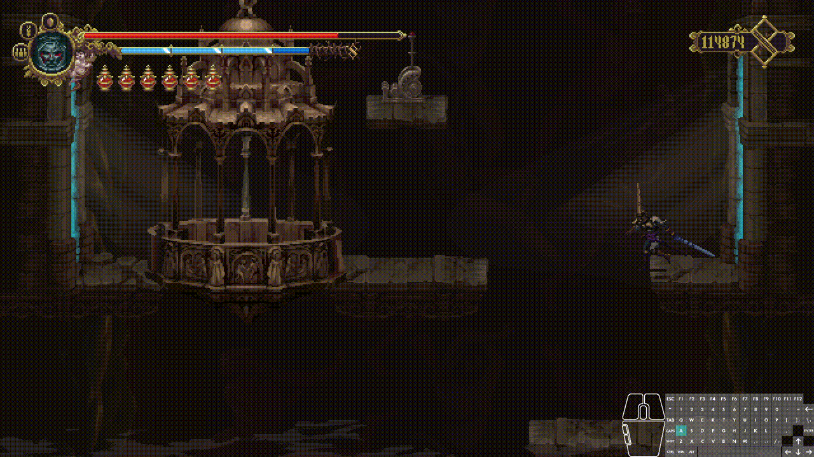

# Blasphemous: Forgiving Spikes

A Blasphemous 1 mod that makes spike, fall, and other trap penalty more forgiving. Highly customizable with other mods or by config.

---

## Features

- Make Penitent respawn after falling into spikes trap or abyss trap, instead of being instakilled. 
- Configurable functionalities, including
  - spike damage (fixed damage / percentage damage)
  - spike damage element & damage type
  - spike ignore defense or not
  - whether to revert to vanilla instakill mechanics
- Supports configurating both through `.cfg` file and public API access through `SpikeUtilities` static class

## Usage

The spike configuration commands are available in both Release and Debug builds:

- `spike current`: show all five fields and values from this mod's global spike configuration.
- `spike set <field> <value>`: update and save one field per invocation. Successful changes persist across launches; invalid fields and values are rejected with the accepted inputs.

Supported fields and values:

- `spikePenaltyType`: `Instakill`, `FixedDamage`, or `PercentageDamage`.
- `spikeDamageAmount`: a `Single` value using `.` as the decimal separator, such as `1.5`, `-1`, or `1e-3`; `NaN`, `Infinity`, and `-Infinity` are also accepted.
- `spikeDamageIgnoreDefense`: `true` or `false`.
- `spikeDamageElement`: `Normal`, `Fire`, `Toxic`, `Lightning`, `Magic`, or `Contact`.
- `spikeDamageType`: `Normal`, `Heavy`, `Critical`, `Simple`, `Stunt`, or `OptionalStunt`.

When `spikePenaltyType` is `PercentageDamage`, `spikeDamageAmount` is a multiplier of Penitent's maximum health: `0.5` means 50%. The `spike respawn` command remains available only in Debug builds.

`SpikePenaltyConfig` has the following configurable fields that you can change in `.cfg` file:

- `spikePenaltyType`: "Instakill", "FixedDamage" or "PercentageDamage"
- `spikeDamageAmount`:
  -  if `spikePenaltyType` is "FixedDamage", then its amount is fixed damage amount
  -  if `spikePenaltyType` is "PercentageDamage", then its amount is multiplied by Penitent's max health
- `spikeDamageIgnoreDefense`: Whether to ignore defense or not 
  - (value: `true` / `false`)
- `spikeDamageElement`: Damage element of the spike
  - (value: `Normal` / `Fire` / `Toxic` / `Lightning` / `Magic`, `Contact`)
- `spikeDamageType`: Damage type of the spike
  - (value: `Normal` / `Heavy` / `Critical` / `Simple` / `Stunt` / `OptionalStunt`)

When JSON omits fields from `globalSpikePenaltyConfig`, defaults are `Instakill`, `0`, `true`, `Normal`, and `Heavy`, respectively. If the entire `globalSpikePenaltyConfig` field is omitted, the config defaults to vanilla instakill behavior.

## Installation

This mod is available for download through the [Blasphemous Mod Installer](https://github.com/BrandenEK/Blasphemous.Modding.Installer)

Required dependencies (dependencies are auto-downloaded if installed through Mod Installer):
- [Modding API](https://github.com/BrandenEK/Blasphemous.ModdingAPI)
- [Cheat Console](https://github.com/brandenEK/Blasphemous.CheatConsole)
